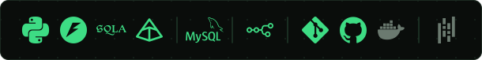

<p align="center">
  
</p>

## Sobre mim

Sou desenvolvedor Backend Python júnior e curso Sistemas de Informação. Tenho experiência prática com APIs, bancos de dados e integrações, e gosto de automatizar tarefas e processos.

Busco evoluir na construção de soluções confiáveis, investigando falhas, testando cenários de erro e entendendo o comportamento do sistema antes de alterá-lo. Também tenho contato com a integração de modelos de linguagem em pipelines, com atenção à validação das respostas e ao que o sistema faz quando uma delas não é adequada.

## Tecnologias

<p align="center">
  
</p>

```text
$ tree ~/stack

~/stack
├── backend/
│   ├── python
│   ├── fastapi
│   ├── sqlalchemy (assíncrono)
│   └── pydantic
├── database/
│   ├── mysql
│   └── sql
├── automation/
│   ├── n8n
│   ├── apis-externas
│   └── integracao-com-ia
├── tools/
│   ├── git
│   ├── github
│   └── docker  # básico
└── learning/
    └── pandas  # em estudo
```

Tecnologias sem indicação ao lado fazem parte da minha experiência prática. Na faixa de ícones, Docker e Pandas aparecem em cinza.

## Projeto

### Automação de e-mails e reuniões com IA

Responder e-mails e marcar reuniões consome tempo em tarefas repetitivas. Dois workflows do n8n cuidam desse trabalho, e respostas, perguntas de horário e reuniões só seguem depois de aprovação humana pelo Telegram.

- E-mails: lê mensagens e anexos (imagens, PDFs e planilhas) e gera a resposta com IA. Se a resposta não é aprovada, ela é reescrita. Se o modelo principal falha, um modelo de reserva (Gemini) assume.
- Reuniões: identifica pedidos de reunião, consulta o Google Calendar e cria o evento depois da aprovação. Quando falta o horário, prepara uma pergunta para pedi-lo, também sujeita à aprovação.

<p>
  
  
  
  
</p>

> Desenvolvido e testado localmente, com n8n em Docker. Não está em produção.

<p>
  <a href="https://github.com/KauaVasco/automacoes-n8n-ia"></a>
  
</p>

## Contato

<p>
  <a href="https://www.linkedin.com/in/kau%C3%A3-vasco-1a0b6037b"></a>
  <a href="mailto:kauatidev@gmail.com"></a>
</p>
